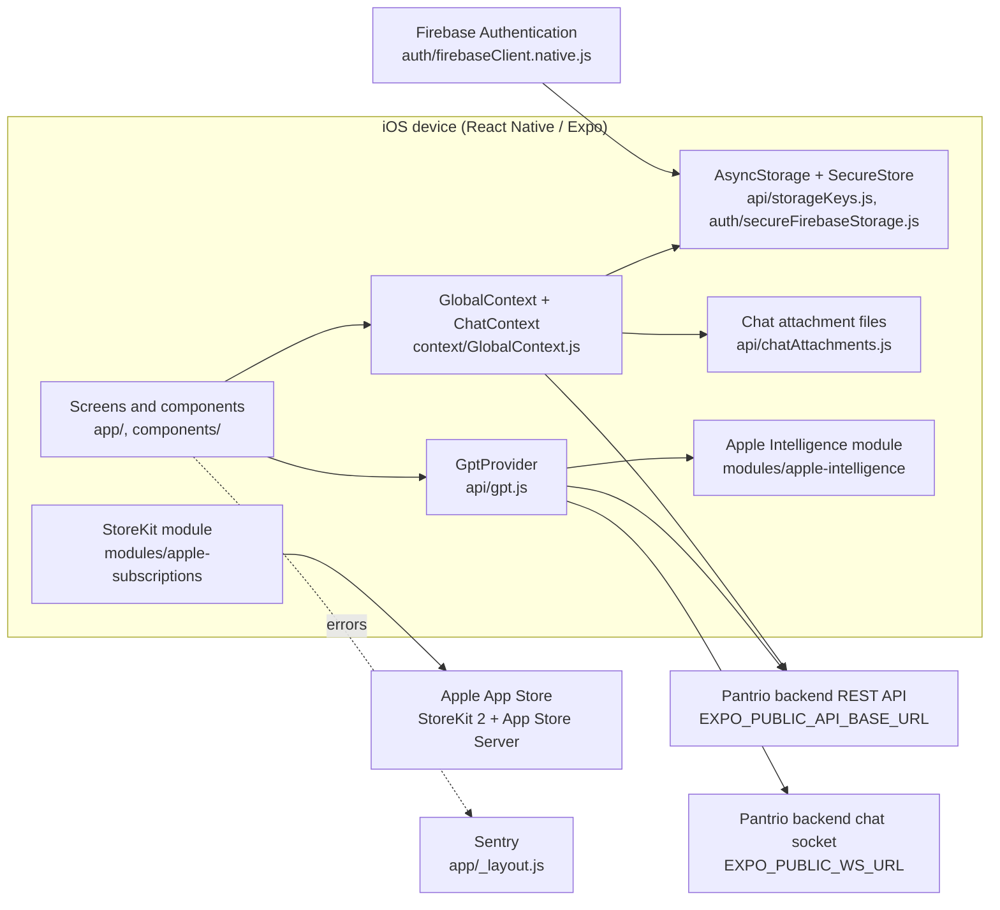
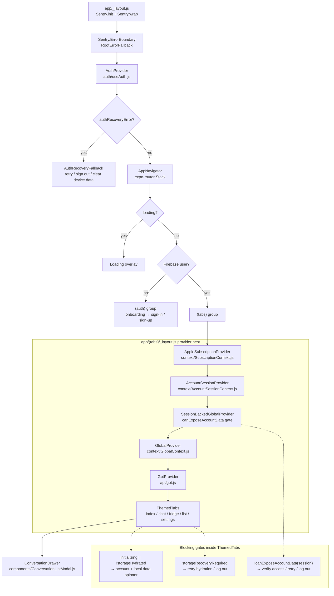
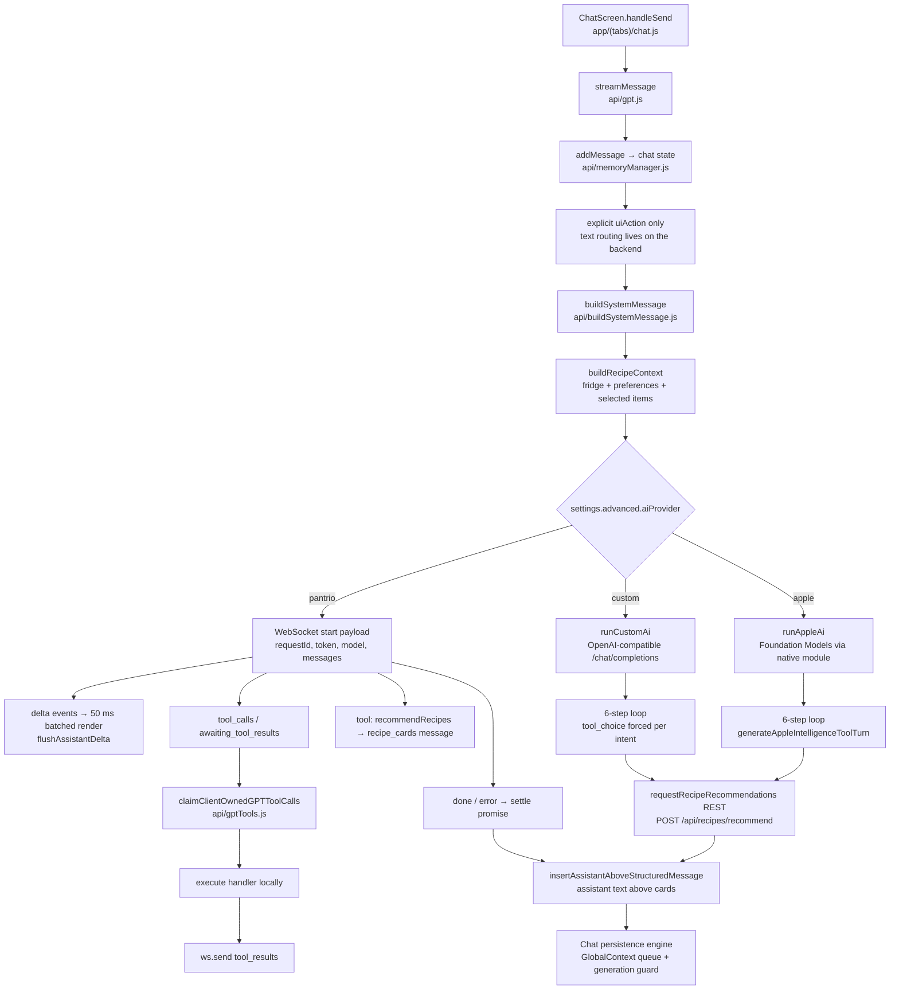
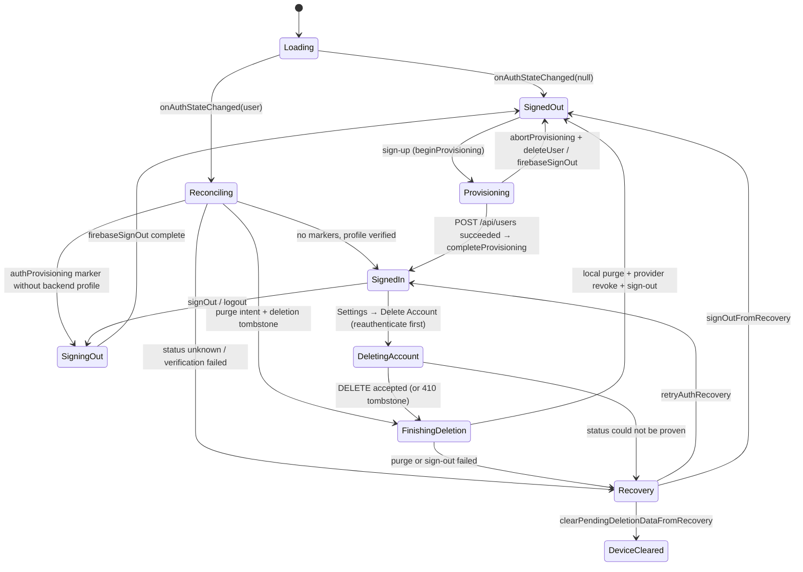
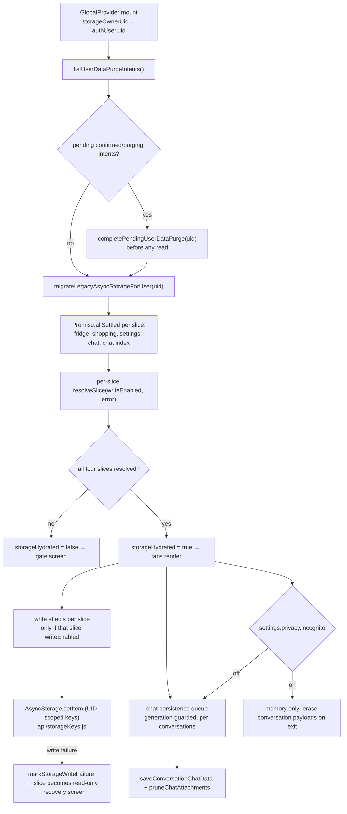
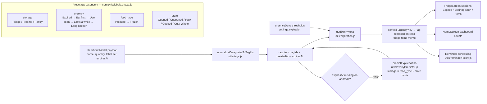
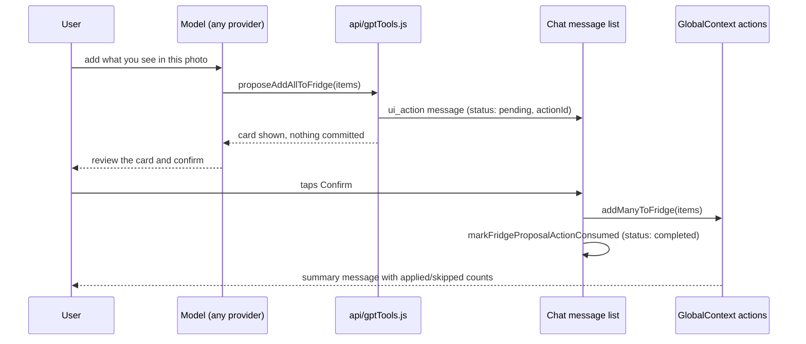

# Pantrio Client — Architecture Flowcharts

Derived from a full read of the repository at commit `c4181d6` (`main`).
Every node below corresponds to a real module or route in the tree; paths are
relative to the repository root.

---

## 1. System context — the client and everything it talks to

The backend is a separate service (not in this repository). The client holds no
OpenAI or Apple server credentials; only `EXPO_PUBLIC_*` build values and the
user's own provider key (SecureStore) ever reach the device.

---

## 2. Boot, provider nesting, and route gating

`GlobalProvider` is mounted twice on purpose: the auth group needs theme and
settings before a session exists, and the tabs group mounts it again with
`authUser` + `accountProfile` so the same state is UID-scoped.

---

## 3. Chat request lifecycle

Failure handling is uniform: `AUTH_REQUIRED`, `QUOTA_EXHAUSTED`,
`RATE_LIMITED`, `REQUEST_TIMEOUT`, `CONNECTION_CLOSED`, and `REQUEST_CANCELLED`
are turned into user-facing text in `getChatErrorMessage` (`chat.js`) and
`backendErrors.js`.

---

## 4. Authentication and account-lifecycle state machine

Durable breadcrumbs (`api/accountLifecycleStorage.js`,
`api/authProvisioningStorage.js`, `api/storageKeys.js` purge intents) are what
make the flow crash-safe: the app would rather stay locked on a verification
screen than publish a half-provisioned or half-deleted account.

---

## 5. Local data: hydration, persistence, and purge

All keys are namespaced as `@pantrio:user:<hex-encoded-uid>:…`, so two accounts
on one device can never read each other's inventory, settings, or chats.

---

## 6. Inventory domain model and derived urgency

Urgency is derived, never stored stale: the persisted item keeps the user's
tags, and `GlobalContext` recomputes and re-stamps the urgency tag on every
read, on a midnight timer and on app foreground.

---

## 7. Confirm-before-commit proposal flow (AI writes)

The same pattern covers `proposeBulkFridgeUpdate`, recipe-preference changes,
and "add missing ingredients to the shopping list". Each proposal carries an
`actionId`, is claimed once via a `Set` in `chat.js`, and is marked consumed in
the message list so a re-render cannot double-apply it.
